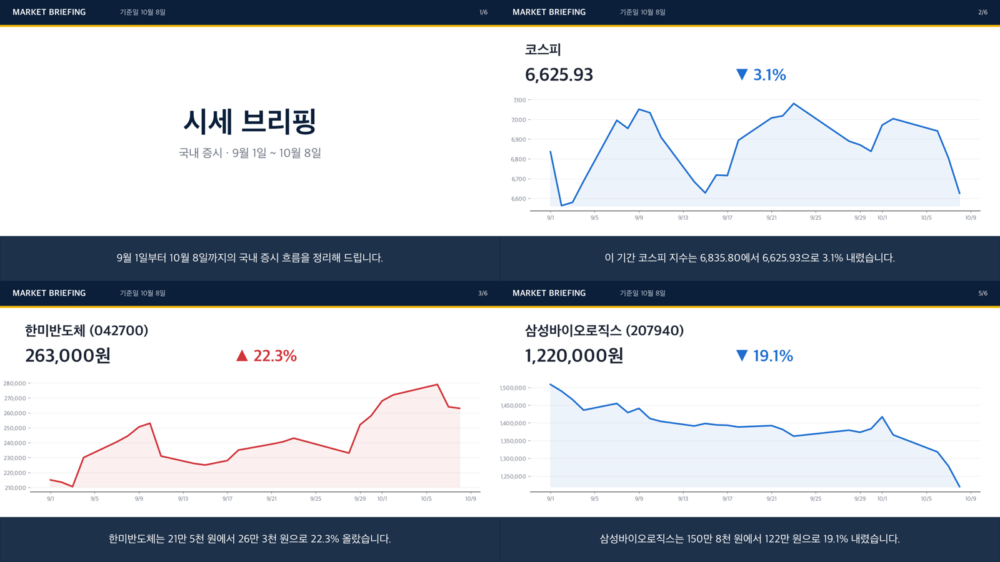

# market-briefing

시세 데이터로 질문에 근거를 붙여 답하고, 변동이 큰 대상을 골라 음성·영상 브리핑을 만드는 프로젝트입니다.
처음에는 KREAM 운영 자동화를 하면서 날짜별로 저장해 둔 시세 스냅샷으로 시작했고, 같은 흐름을 국내 주식 일별 종가에도 연결했습니다.

1. **근거 기반 질의응답(RAG)** — "SK하이닉스 주가는 어땠어?" 같은 질문에, 검색된 시세 문서만 근거로 출처를 붙여 답합니다.
2. **Function Calling 에이전트** — 로컬 LLM이 검색·순위 계산 도구를 골라 인자를 채우고, 코드는 그 인자를 검증한 뒤에만 실행합니다.
3. **MCP 서버** — 같은 도구를 Claude Code 같은 MCP 클라이언트에서 쓸 수 있게 노출합니다.
4. **증시 브리핑 영상** — 경제 방송의 브리핑 형식(오프닝 → 코스피 지수 → 종목별 장면 → 클로징)으로, 장면마다 낭독 음성과 자막을 맞춘 영상을 만듭니다.

| 데이터 | 출처 | 규모 |
|---|---|---|
| KREAM 즐겨찾기 스냅샷 | 운영 중 직접 저장한 xlsx (비공개, 가상 샘플 포함) | 9회 관측, 상품·옵션 91개 |
| 국내 주식 일별 종가 | [FinanceDataReader](https://github.com/FinanceData/FinanceDataReader) (무료, API 키 불필요) | KOSPI 시가총액 상위 30종목, 2026-09-01 ~ 10-08 |

임베딩과 답변 생성은 [Ollama](https://ollama.com) 로컬 모델(bge-m3, qwen2.5:3b), 음성은 macOS 내장 TTS, 영상은 ffmpeg로 처리합니다. 외부 API를 쓰지 않아 비용이 들지 않고 데이터가 밖으로 나가지 않습니다.



▶ 영상 예시: [증시 브리핑 (40초, 6장면)](docs/newscast-demo.mp4) · [국내 주식 차트 브리핑](docs/stock-briefing-demo.mp4) · [KREAM 차트 브리핑](docs/briefing-demo.mp4)

증시 브리핑 낭독 원고(전부 데이터에서 만든 문장):

> 9월 1일부터 10월 8일까지의 국내 증시 흐름을 정리해 드립니다. 이 기간 코스피 지수는 6,835.80에서 6,625.93으로 3.1% 내렸습니다. 한미반도체는 21만 5천 원에서 26만 3천 원으로 22.3% 올랐습니다. SK이노베이션은 13만 5천 원에서 16만 1천 원으로 19.4% 올랐습니다. 삼성바이오로직스는 150만 8천 원에서 122만 원으로 19.1% 내렸습니다. …

## 예시

### 국내 주식 (KOSPI 상위 30종목)

| 질문 | 처리 | 결과 |
|---|---|---|
| 삼성 이름 들어간 종목 중 가장 많이 오른 건? (`agent`) | 모델이 `rank_movers(direction="up", keyword="삼성", n=1)` 호출 → 코드 검증 후 계산 | 삼성전기 +9.0% (대상 8종목) |
| 가장 많이 내린 종목은? (`ask`) | 순위 질문 → 전체 문서 계산 | 삼성바이오로직스 1,508,299원 → 1,220,000원, -19.1% |
| SK하이닉스 주가는 어땠어? (`agent`) | 모델이 `search_prices` 호출 → 근거 문서 반환 | 25거래일, 1,693,000원 → 1,686,000원(-0.4%), 최고 1,879,000원(9월 21일) |
| 비트코인 시세 알려줘 (`ask`) | 근거 문서 없음 | 제공된 데이터로는 답할 수 없습니다. |

### KREAM 스냅샷

실제 스냅샷 9개(2026-01-30 ~ 03-06, 상품·옵션 91개)로 실행한 결과입니다.

| 질문 | 답변 | 처리 경로 |
|---|---|---|
| 에르메스 브레이슬릿 시세는 어떻게 변했어? | 투니스 트레세 브레이슬릿은 -0.7%, 클릭아슈 브레이슬릿은 +8.0% 변했다고 답하고 근거 문서 4건을 함께 반환 | 임베딩 검색 → LLM → 숫자 대조 통과 |
| 가장 많이 오른 셀린느 가방 가격 알려줘 | 셀린느 13개 상품 중 미디움 아바 트리옹프 백이 2,830,000원 → 3,650,000원(+29.0%) | 순위 질문 → 전체 문서 계산(모델 미사용) |
| 비트코인 시세 알려줘 | 제공된 데이터로는 답할 수 없습니다. | 검색 후 모델이 근거 없음으로 답변 거절 |

브리핑 원고(기본 모드):

> 1월 30일부터 3월 6일까지 관측한 KREAM 시세 가운데 변동이 컸던 상품 3개를 전해 드립니다. 셀린느 미디움 아바 트리옹프 백 스무스 카프스킨 블랙(본품+더스트백)은 1월 30일 283만 원에서 2월 13일 365만 원으로 29.0% 올랐습니다. …

## 동작 방식

```
스냅샷 xlsx ─▶ 상품·옵션별 시계열 ─▶ 요약 문서 (변동률·최저·최고가는 코드가 계산)
                                        │
                                bge-m3 임베딩 색인
                                        │
질문 ─┬─ "가장 많이 오른/내린 …" ─▶ 전체 문서에서 계산해 답변
      └─ 그 외 ─▶ 코사인 상위 k ─▶ 유사도 0.45 미만이면 '답할 수 없음'
                              └─▶ qwen2.5:3b 답변 ─▶ 숫자 대조 ─▶ 출처와 함께 반환

변동 상위 n개 ─▶ 원고(데이터로 문장 고정 | --llm-script) ─▶ macOS say ─┐
              └▶ matplotlib 차트 ──────────────────────────────────────┴▶ ffmpeg mp4

증시 브리핑: 장면 계획(지수·종목) ─▶ 장면별 TTS → 길이 측정 ─▶ 장면 이미지(헤드라인·차트·자막) ─▶ 장면별 mp4 ─▶ ffmpeg concat
```

## 설계하면서 정한 것

**모델이 실행 경로를 고르되, 인자와 숫자는 코드가 검증한다.** Function Calling 에이전트(`agent.py`)에서 모델이 고른 도구 이름과 인자는 스키마로 확인한 뒤에만 실행합니다. 모르는 도구나 범위를 벗어난 인자는 실행하지 않고, 오류 내용을 모델에게 돌려줘 한 번 더 고칠 기회를 줍니다. 소형 모델이 도구를 부르지 않고 추측으로 답하거나, 근거를 찾고도 "답할 수 없다"고 하는 경우가 실제로 있어서, 도구 없이 나온 답은 받지 않고 근거가 있는데 거절하면 근거 문서를 그대로 보여 줍니다.

**숫자는 모델이 만들지 않는다.** 변동률·최저가·최고가는 문서를 만들 때 코드로 계산하고, 모델은 문서에 적힌 값을 옮기기만 합니다. 답변이나 원고에 근거 문서에 없는 숫자가 하나라도 나오면 내보내지 않습니다(`grounding.py`). 문장의 의미까지 판정하지는 못하지만, 지어낸 가격은 확실히 걸러집니다.

**관련 문서가 없으면 모델을 부르지 않는다.** 검색 유사도가 기준 미만이면 바로 "답할 수 없음"을 돌려줍니다. 기준값 0.45는 실제 데이터에서 무관한 질문의 최고 유사도를 보고 정했습니다.

**순위를 묻는 질문은 검색하지 않는다.** 처음에는 "가장 많이 오른 셀린느 가방"도 임베딩 검색으로 처리했는데, 검색은 상위 k개 문서만 보기 때문에 그 안에서 가장 오른 +7.1% 상품을 답했습니다. 실제 최댓값은 +29.0%였습니다. 이런 집계 질문은 이름으로 대상을 거른 뒤 전체 문서에서 계산해 답하도록 경로를 나눴습니다.

**브리핑 원고의 수치 문장은 데이터로 고정한다.** 처음에는 원고 전체를 로컬 LLM이 쓰고 숫자 대조를 거치게 했습니다. 그런데 숫자는 맞게 옮기면서 실제로 오른 상품을 "하락했다"고 쓰는 경우가 있었고, 숫자 대조로는 이런 방향 오류를 잡을 수 없었습니다. 그래서 기본 원고는 데이터에서 문장을 만들고, LLM 원고는 `--llm-script` 옵션으로 남겨 두었습니다. 낭독에 맞게 금액은 "283만 원", 날짜는 "2월 13일"로 바꿉니다.

## 한계

- 스냅샷이 9개이고 관측 간격이 일정하지 않습니다. 상품마다 관측 횟수도 달라, 변동률은 "첫 관측 대비 마지막 관측"이라는 단순한 값입니다.
- 숫자 대조는 문장 의미를 보지 않습니다. 근거에 있는 숫자를 엉뚱한 상품에 붙이는 오류는 잡지 못합니다.
- 코스피 지수는 FinanceDataReader의 Yahoo 경로(`^KS11`)를 씁니다. 기본 경로는 이 기간 데이터가 중간까지만 있었습니다.
- 주식 종가는 FinanceDataReader가 주는 값을 그대로 써서, 일부 종목은 수정주가로 소수 단위가 섞입니다(예: 1,508,299원).
- 이름 필터는 종목명 문자열만 봅니다. "반도체 종목"처럼 업종으로 묻는 질문은 업종 정보가 없어 정확히 거르지 못합니다.
- `ask`의 순위 질문 판별은 정규식 기반이라 "제일 비싸게 팔리는" 같은 표현은 아직 일반 검색 경로로 갑니다.
- 소형 모델(qwen2.5:3b)이라 답변 문장이 다소 딱딱하고, 같은 문장을 반복하는 경우가 있어 생성 길이에 상한을 두었습니다.

## 실행

macOS 기준입니다(TTS에 `say`를 씁니다).

```bash
brew install ollama ffmpeg
ollama serve &
ollama pull bge-m3 && ollama pull qwen2.5:3b

python3 -m venv .venv && .venv/bin/pip install -e ".[dev]"

# 저장소에 포함된 가상 샘플 데이터로 실행
.venv/bin/market-briefing --data examples/sample_data index
.venv/bin/market-briefing ask "러닝화 시세는 어떻게 변했어?"
.venv/bin/market-briefing agent "가장 많이 내린 상품은?"
.venv/bin/market-briefing brief --out out      # out/script.txt, chart.png, briefing.aiff, briefing.mp4

# 국내 주식 종가로 실행
.venv/bin/market-briefing --index data/index-stocks index-stocks --start 2026-09-01 --end 2026-10-10 --top 30
.venv/bin/market-briefing --index data/index-stocks agent "삼성 이름 들어간 종목 중 가장 많이 오른 건?"
.venv/bin/market-briefing --index data/index-stocks newscast   # out-newscast/newscast.mp4
```

MCP 서버로 쓰려면 Claude Code에 등록합니다.

```bash
claude mcp add market-briefing -e MARKET_BRIEFING_INDEX=$PWD/data/index-stocks -- $PWD/.venv/bin/python -m market_briefing.mcp_server
```

실제 운영 스냅샷은 개인 데이터라 저장소에 넣지 않았습니다. `examples/sample_data`는 같은 형식으로 만든 가상 데이터이며 `scripts/make_sample_data.py`로 다시 만들 수 있습니다.

## 테스트

```bash
.venv/bin/python -m pytest -q
```

임베딩과 LLM은 상품명 키워드로 만든 가짜 임베더와 순서대로 응답하는 가짜 모델로 바꿔 끼워서, 모델 없이도 검색·거절·숫자 대조·원고 재시도·순위 계산·도구 인자 검증·MCP 도구·브리핑 장면 문장을 확인합니다(35개).

## 구조

```
market_briefing/
  snapshots.py   스냅샷 xlsx → 관측 행
  documents.py   시계열 요약 문서, 낭독용 표기, 변동 상위 계산
  grounding.py   생성 결과의 숫자 대조
  stocks.py      국내 주식 일별 종가 → 시세 문서
  retrieval.py   임베딩 색인, 순위 질문 분기, 근거 기반 답변
  agent.py       Function Calling 에이전트 (도구 선택·인자 검증·근거 대조)
  mcp_server.py  MCP 서버 (search_prices, rank_movers, make_briefing)
  media.py       원고 작성, 차트, TTS, ffmpeg 합성
  newscast.py    증시 브리핑(장면 계획, 장면별 음성·자막, 영상 이어 붙이기)
  models.py      Ollama 호출 (테스트에서 교체)
  cli.py         index / ask / brief
```
