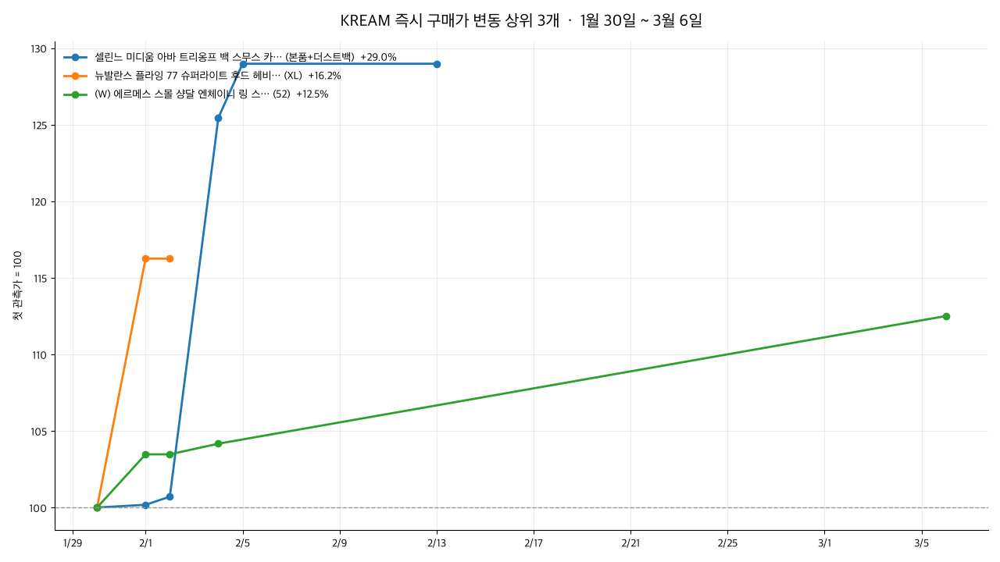

# market-briefing

KREAM 운영 자동화를 하면서 날짜별로 저장해 둔 시세 스냅샷으로 만든 두 가지 기능입니다.

1. **근거 기반 질의응답(RAG)** — "에르메스 브레이슬릿 시세는 어떻게 변했어?" 같은 질문에, 검색된 시세 문서만 근거로 출처를 붙여 답합니다.
2. **시세 브리핑 음성·영상** — 관측 기간 동안 변동이 컸던 상품을 골라 낭독 원고를 만들고, 음성과 차트를 합쳐 짧은 브리핑 영상으로 내보냅니다.

임베딩과 답변 생성은 [Ollama](https://ollama.com) 로컬 모델(bge-m3, qwen2.5:3b), 음성은 macOS 내장 TTS, 영상은 ffmpeg로 처리합니다. 외부 API를 쓰지 않아 비용이 들지 않고 데이터가 밖으로 나가지 않습니다.



▶ [브리핑 영상 예시 (50초, mp4)](docs/briefing-demo.mp4)

## 예시

실제 스냅샷 9개(2026-01-30 ~ 03-06, 상품·옵션 91개)로 실행한 결과입니다.

| 질문 | 답변 | 처리 경로 |
|---|---|---|
| 에르메스 브레이슬릿 시세는 어떻게 변했어? | 투니스 트레세 브레이슬릿은 -0.7%, 클릭아슈 브레이슬릿은 +8.0% 변했다고 답하고 근거 문서 4건을 함께 반환 | 임베딩 검색 → LLM → 숫자 대조 통과 |
| 가장 많이 오른 셀린느 가방 가격 알려줘 | 셀린느 13개 상품 중 미디움 아바 트리옹프 백이 2,830,000원 → 3,650,000원(+29.0%) | 순위 질문 → 전체 문서 계산(모델 미사용) |
| 비트코인 시세 알려줘 | 제공된 데이터로는 답할 수 없습니다. | 검색 후 모델이 근거 없음으로 답변 거절 |

브리핑 원고(기본 모드):

> 1월 30일부터 3월 6일까지 관측한 KREAM 시세 가운데 변동이 컸던 상품 3개를 전해 드립니다. 셀린느 미디움 아바 트리옹프 백 스무스 카프스킨 블랙(본품+더스트백)은 1월 30일 283만 원에서 2월 13일 365만 원으로 29.0% 올랐습니다. …

## 동작 방식

```
스냅샷 xlsx ─▶ 상품·옵션별 시계열 ─▶ 요약 문서 (변동률·최저·최고가는 코드가 계산)
                                        │
                                bge-m3 임베딩 색인
                                        │
질문 ─┬─ "가장 많이 오른/내린 …" ─▶ 전체 문서에서 계산해 답변
      └─ 그 외 ─▶ 코사인 상위 k ─▶ 유사도 0.45 미만이면 '답할 수 없음'
                              └─▶ qwen2.5:3b 답변 ─▶ 숫자 대조 ─▶ 출처와 함께 반환

변동 상위 n개 ─▶ 원고(데이터로 문장 고정 | --llm-script) ─▶ macOS say ─┐
              └▶ matplotlib 차트 ──────────────────────────────────────┴▶ ffmpeg mp4
```

## 설계하면서 정한 것

**숫자는 모델이 만들지 않는다.** 변동률·최저가·최고가는 문서를 만들 때 코드로 계산하고, 모델은 문서에 적힌 값을 옮기기만 합니다. 답변이나 원고에 근거 문서에 없는 숫자가 하나라도 나오면 내보내지 않습니다(`grounding.py`). 문장의 의미까지 판정하지는 못하지만, 지어낸 가격은 확실히 걸러집니다.

**관련 문서가 없으면 모델을 부르지 않는다.** 검색 유사도가 기준 미만이면 바로 "답할 수 없음"을 돌려줍니다. 기준값 0.45는 실제 데이터에서 무관한 질문의 최고 유사도를 보고 정했습니다.

**순위를 묻는 질문은 검색하지 않는다.** 처음에는 "가장 많이 오른 셀린느 가방"도 임베딩 검색으로 처리했는데, 검색은 상위 k개 문서만 보기 때문에 그 안에서 가장 오른 +7.1% 상품을 답했습니다. 실제 최댓값은 +29.0%였습니다. 이런 집계 질문은 이름으로 대상을 거른 뒤 전체 문서에서 계산해 답하도록 경로를 나눴습니다.

**브리핑 원고의 수치 문장은 데이터로 고정한다.** 처음에는 원고 전체를 로컬 LLM이 쓰고 숫자 대조를 거치게 했습니다. 그런데 숫자는 맞게 옮기면서 실제로 오른 상품을 "하락했다"고 쓰는 경우가 있었고, 숫자 대조로는 이런 방향 오류를 잡을 수 없었습니다. 그래서 기본 원고는 데이터에서 문장을 만들고, LLM 원고는 `--llm-script` 옵션으로 남겨 두었습니다. 낭독에 맞게 금액은 "283만 원", 날짜는 "2월 13일"로 바꿉니다.

## 한계

- 스냅샷이 9개이고 관측 간격이 일정하지 않습니다. 상품마다 관측 횟수도 달라, 변동률은 "첫 관측 대비 마지막 관측"이라는 단순한 값입니다.
- 숫자 대조는 문장 의미를 보지 않습니다. 근거에 있는 숫자를 엉뚱한 상품에 붙이는 오류는 잡지 못합니다.
- 순위 질문 판별은 정규식 기반이라 "제일 비싸게 팔리는" 같은 표현은 아직 일반 검색 경로로 갑니다.
- 소형 모델(qwen2.5:3b)이라 답변 문장이 다소 딱딱하고, 같은 문장을 반복하는 경우가 있어 생성 길이에 상한을 두었습니다.

## 실행

macOS 기준입니다(TTS에 `say`를 씁니다).

```bash
brew install ollama ffmpeg
ollama serve &
ollama pull bge-m3 && ollama pull qwen2.5:3b

python3 -m venv .venv && .venv/bin/pip install -e ".[dev]"

# 저장소에 포함된 가상 샘플 데이터로 실행
.venv/bin/market-briefing --data examples/sample_data index
.venv/bin/market-briefing ask "러닝화 시세는 어떻게 변했어?"
.venv/bin/market-briefing ask "가장 많이 내린 상품은?"
.venv/bin/market-briefing brief --out out      # out/script.txt, chart.png, briefing.aiff, briefing.mp4
```

실제 운영 스냅샷은 개인 데이터라 저장소에 넣지 않았습니다. `examples/sample_data`는 같은 형식으로 만든 가상 데이터이며 `scripts/make_sample_data.py`로 다시 만들 수 있습니다.

## 테스트

```bash
.venv/bin/python -m pytest -q
```

임베딩과 LLM은 상품명 키워드로 만든 가짜 임베더와 고정 응답으로 바꿔 끼워서, 모델 없이도 검색·거절·숫자 대조·원고 재시도·순위 계산을 확인합니다.

## 구조

```
market_briefing/
  snapshots.py   스냅샷 xlsx → 관측 행
  documents.py   시계열 요약 문서, 낭독용 표기, 변동 상위 계산
  grounding.py   생성 결과의 숫자 대조
  retrieval.py   임베딩 색인, 순위 질문 분기, 근거 기반 답변
  media.py       원고 작성, 차트, TTS, ffmpeg 합성
  models.py      Ollama 호출 (테스트에서 교체)
  cli.py         index / ask / brief
```
